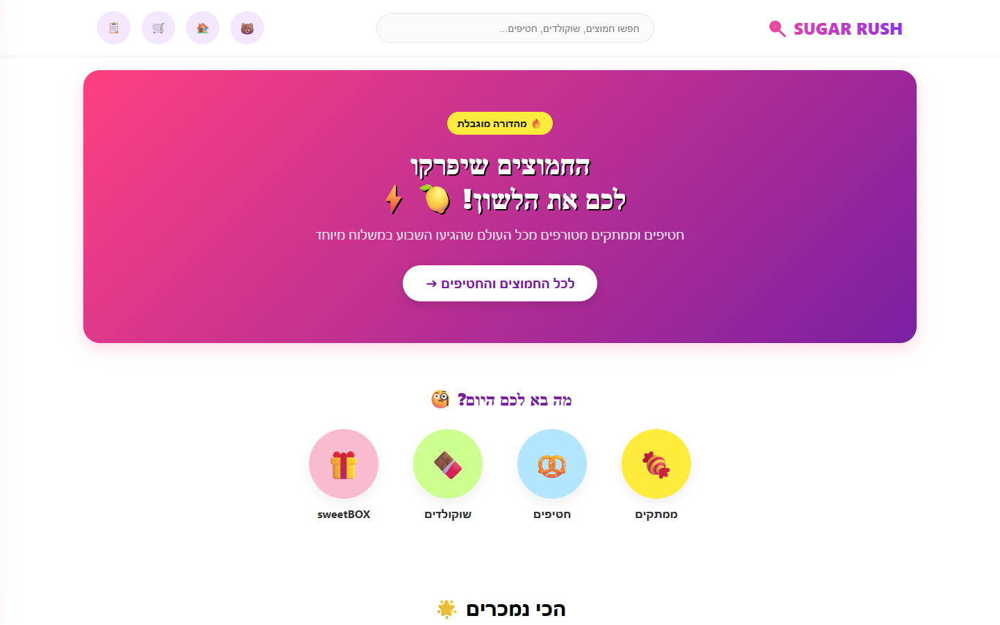

# SUGAR RUSH 🍭 – Online Candy Store

A full-stack MERN e-commerce store for candy, snacks, chocolates and gift boxes, with a Hebrew (RTL) interface, JWT authentication and an admin dashboard.

<!-- Add screenshots here, for example:


-->

## Features

### Customers
- Register and log in with JWT; passwords are hashed with bcrypt
- Browse the catalog with real-time search, category filters and price sorting
- Shopping cart that persists across page reloads and is limited by available stock
- Checkout that creates an order; prices are calculated on the server from the database
- "My Orders" page with order status, and cancellation of pending orders (stock is restored)

### Admin
- Order management: change order status, filter by status, revenue summary
- Best-sellers report computed from real orders using MongoDB Aggregation
- User management: grant/revoke admin role, block/unblock users
- Add and edit products
- Soft delete products and restore them from the "deleted products" page
- Low-stock indicators on product cards

## Tech Stack

| Layer    | Technologies                                        |
|----------|-----------------------------------------------------|
| Frontend | React, Redux Toolkit, React Router, Axios, Vite     |
| Backend  | Node.js, Express, JWT, bcrypt                       |
| Database | MongoDB, Mongoose                                   |

## Project Structure

```
├── nodeJS/            # Express REST API
│   ├── controller/    # Route handlers (business logic)
│   ├── models/        # Mongoose schemas
│   ├── routers/       # API routes + auth middleware
│   ├── database.js    # MongoDB connection
│   └── app.js         # Server entry point
└── react/             # React client (Vite)
    └── src/
        ├── api/       # API calls (axios)
        ├── slice/     # Redux Toolkit slices
        └── components/
```

## Getting Started

### Prerequisites
- Node.js 18+
- MongoDB (local or MongoDB Atlas)

### 1. Install dependencies
```bash
cd nodeJS && npm install
cd ../react && npm install
```

### 2. Configure the server
Create `nodeJS/.env` based on `nodeJS/.env.example`:
```env
DB_URI=mongodb://localhost:27017/candys
JWT_SECRET=your_secret_key
PORT=5000
```

### 3. Run
From the project root, in two terminals:
```bash
npm run server   # API at http://localhost:5000
npm run client   # Client at http://localhost:5173
```

## API Overview

| Resource      | Base route     | Examples                                              |
|---------------|----------------|-------------------------------------------------------|
| Auth          | `/auth`        | register, login                                       |
| Products      | `/products`    | list, by category, add / update / delete (admin)      |
| Categories    | `/categories`  | list                                                  |
| Orders        | `/orders`      | add order, my orders, all orders (admin), best sellers |
| Users         | `/users`       | list, update role / status (admin)                    |

Protected routes require an `Authorization: Bearer <token>` header.

## Notes
- The checkout page is a demo: no real payment is processed.
